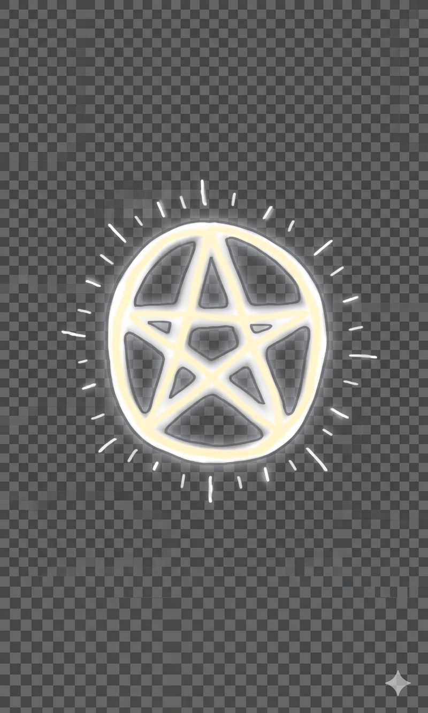

# 
✦ THE VEIL ✦

<i>Tarot · Astrology · Divination · Ritual Intelligence</i>

  
  

  

---

## 🌒 Overview
**The Veil** is a high-fidelity, single-page web application designed as a digital sanctuary for the modern practitioner. It bridges ancient hermetic wisdom with a clean, "Gold-on-Ink" aesthetic to provide an immersive experience for self-reflection and occult study.

---

## 🧭 Core Features

### 🎴 Sacred Readings (Draws)
The heart of the application, where users consult the cards for guidance.
* **The Magick:** Mimics the physical act of cutting the deck. It uses a randomized engine to pull cards that reflect your current energetic frequency, acting as a mirror for the subconscious mind.

### 📖 The Great Archives (Library)
A comprehensive, searchable database of all 78 Tarot cards.
* **The Magick:** Acts as a *Digital Grimoire* for study and meditation, housing the archetypal journey of the Fool and elemental associations.

### 🕯️ Mystical Reference Guide
A modular encyclopedia for ritual correspondences, featuring optimized grids for **Candles, Crystals, Herbs, and Deities**.
* **The Magick:** Ensures that the "intent" of a ritual matches the "frequency" of the materials used—essential for successful manifestation.

---

## 🗺️ Project Roadmap

| Phase | Title | Features | Status |
| :--- | :--- | :--- | :--- |
| **🌑 I** | **Waxing Moon** | Custom Deck Uploads, Sigil Generator (Kamea), **Grimoire PDF Export** | 🚧 In Progress |
| **🌓 II** | **First Quarter** | Transit Overlays, Relationship Analysis (Synastry Reports), Aspect Grid | 📅 Planned |
| **🌕 III** | **Full Moon** | Moon Phase Tracker, Ritual Journal (Local Storage), Reverse Card Logic | 🔮 Vision |

---

## 🛠️ Technical Architecture
* **Frontend:** Vanilla JavaScript (ES6+), HTML5, CSS3.
* **Typography:** [Cinzel](https://fonts.google.com/specimen/Cinzel) & [Spectral](https://fonts.google.com/specimen/Spectral).
* **Data:** Modular JSON Archives (`reference.json`, `tarot.json`).

---

## 📜 The Philosophy of The Veil
> *"As above, so below; as within, so without."*

The Veil is built on the principle that **magic is an interface**. Just as a physical deck is a tool for the mind, this application is a conduit for intention. It is designed to be a quiet, respectful space for the **Great Work**.

---

## 🕯️ Maintenance & Contribution
To update the local mystical data, refresh the `data/*.json` files. If you find a "glitch in the veil" (a bug), please open an Issue on GitHub.

  <i>"The lips of wisdom are closed, except to the ears of Understanding."</i> 
  <b>Blessed Be.</b>

